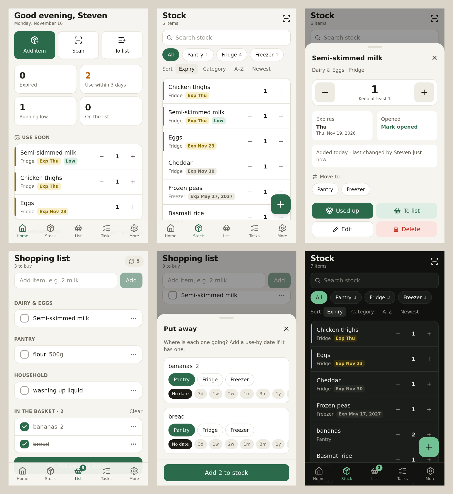

# Larder

A self-hosted app for a household's food: what's in the pantry, fridge and freezer, what's about to go off, the shopping list, and the kitchen jobs that keep coming round. It's built for phones on a VPN. It installs to the home screen, opens instantly, and keeps working with no signal.



## What it does

- **Stock.** Track items by place (pantry, fridge, freezer, or your own like "garage freezer"), with quantity, unit, use-by date, opened date and notes. Tap − and + to use things up. Search, filter by place, and sort by expiry, category, name or newest.
- **Use soon.** The home screen shows what's expired or expiring in the next week, colour-coded, and what's running low.
- **Staples.** Mark an item "always keep in stock". When it drops to its minimum it adds itself to the shopping list.
- **Shopping list.** Quick add understands `2 milk`, `500g flour` and `3x eggs`. Items are grouped by aisle, and anything running low is suggested. Tick things off in the shop, then **Put away**: Larder asks where each one goes, suggesting where you kept it last time, and tops up your stock.
- **Barcodes.** Scan with the phone camera. A product you've added before is recognised instantly, even offline. A new one is looked up on [Open Food Facts](https://world.openfoodfacts.org) for its name and category; only the barcode number is sent.
- **Learns your kitchen.** Larder remembers each product's category, unit, usual place and shelf life, so the next time you add it, it's pre-filled.
- **Tasks.** Kitchen jobs with due dates and optional repeats ("clean out the fridge, every 2 weeks"). Ticking a repeating task rolls it forward.
- **Household.** Several accounts share one larder. Changes on one phone appear on the others within a second.
- **Offline first.** Everything works with no connection. Changes queue up and sync when you're back, and the header shows how many are waiting.
- Dark mode, export to JSON, nightly database backups, and a one-tap backup download.

## Run it

Requires Docker.

```bash
docker compose up -d --build
```

Larder now listens on `127.0.0.1:8787` on this machine only. Data, including the SQLite database and `backups/`, lives in `./data`.

### Reach it from your phone: HTTPS over Tailscale

Phones only allow installing to the home screen, offline mode (service workers) and the camera on **HTTPS**. Tailscale can serve HTTPS for this machine, with a real certificate, to your tailnet only:

```bash
sudo tailscale serve --bg --https=443 http://127.0.0.1:8787
tailscale serve status        # shows the https://<machine>.<tailnet>.ts.net URL
```

If it says HTTPS isn't enabled, turn on **MagicDNS** and **HTTPS Certificates** in the Tailscale admin console (DNS page), then run it again. To stop serving: `sudo tailscale serve --https=443 off`.

This uses `serve`, not `funnel`, so it is never exposed to the public internet.

### First run and install

1. Open the `https://…ts.net` address on your phone and create the owner account. The first visitor sets up the household, so do this straight away.
2. **iPhone:** in Safari tap **Share → Add to Home Screen**. **Android:** in Chrome tap **⋮ → Install app**.
3. Add the rest of the household under **More → Household → Add**.

## Configuration

Set these in `compose.yaml` under `environment`:

| Variable | Default | What it does |
|---|---|---|
| `LARDER_BARCODE_LOOKUP` | `on` | Look up unknown barcodes on Open Food Facts. `off` keeps Larder fully offline. |
| `LARDER_BACKUP_KEEP` | `14` | Database snapshots to keep in `data/backups/`. `0` disables them. |
| `LARDER_BACKUP_INTERVAL_HOURS` | `24` | How often to take a snapshot. |
| `LARDER_TRUST_PROXY` | `0` (`1` in compose) | Trust `X-Forwarded-For`, so login throttling sees real client addresses behind a proxy. |
| `LARDER_LOG_REQUESTS` | `1` | Log one line per API request. |
| `PORT`, `HOST`, `DATA_DIR` | `8787`, `127.0.0.1`, `./data` | Listener and storage location. |
| `TZ` | `UTC` | Time zone for logs. |

## Backups and restore

- Snapshots are written to `data/backups/larder-YYYYMMDD-HHMMSS.db` on start (if none is recent) and every 24 h. They're consistent copies made with SQLite's `VACUUM INTO` while the app runs.
- **More → Download database backup** (owner only) gives you a fresh snapshot. **Export everything** gives readable JSON.
- To restore: `docker compose down`, copy a snapshot over `data/larder.db`, delete `data/larder.db-wal` and `data/larder.db-shm`, then `docker compose up -d`. Phones notice the server went back in time and re-download everything automatically. Edits still waiting on a phone are sent again and applied where the item still exists.

## Updating

```bash
git pull && docker compose up -d --build
```

Open apps show "A new version of Larder is ready · Reload". Nothing reloads while you're mid-edit.

## How it works

```
 phone (React PWA)                                server (Node 26, one process)
 ┌──────────────────────────────┐                ┌──────────────────────────────┐
 │ UI ── reads ──▶ IndexedDB     │  POST /api/sync │ Hono ─▶ sync engine          │
 │  │             (Dexie)        │ ──────────────▶ │          │                   │
 │  └─ writes ──▶ table + outbox │  push ops,      │          ▼                   │
 │                    │          │  pull changes   │  SQLite (node:sqlite, WAL)   │
 │   sync engine ◀────┘          │ ◀────────────── │  records(json, version)      │
 │   ▲                           │                 │          │                   │
 │   └──── "changed" ◀───────────┼─ SSE /api/events ◀─────────┘                   │
 │ service worker: app shell     │                 │                              │
 └──────────────────────────────┘                └──────────────────────────────┘
```

- **Local first.** The UI only reads the phone's IndexedDB copy. A change is written locally together with an op in an outbox, in one transaction, so the screen updates instantly with or without a connection.
- **Sync.** `POST /api/sync` pushes outbox ops and pulls every record changed since the phone's cursor, both in one SQLite transaction. Ops are **field-level patches**: if two people edit different fields of the same item, both edits survive. Ops carry ids, so a retried request never applies twice. **Deletes are final**: an edit that races a delete is dropped, and undo re-creates the item. Ops still waiting in the outbox are replayed over incoming data, so your unsynced edits are never flickered away.
- **Validation.** One set of [Zod](https://zod.dev) schemas in `shared/` is enforced on the phone, before anything is queued, and again on the server. If the server ever rejects something, the phone re-downloads to undo it and says so.
- **Live updates.** Each open app holds a Server-Sent Events stream. After a sync that changed something, the others get a nudge and sync. A phone also syncs on launch, when it comes back online or to the foreground, and every minute while open.
- **Stack.** React 19, React Router, Tailwind CSS 4, Dexie, Vite and vite-plugin-pwa (Workbox) on the front. Hono and Node's built-in `node:sqlite` on the back. The server runs its TypeScript directly with Node's type stripping and has no native dependencies. Barcodes use the native `BarcodeDetector` on Android and a self-hosted ZXing WebAssembly build on iPhone, so nothing loads from a CDN.

### Security

- Passwords are hashed with scrypt. Sessions are random 256-bit tokens stored as SHA-256 hashes, in an `HttpOnly`, `SameSite=Lax` cookie (`Secure` over HTTPS) with a sliding 180-day expiry.
- Every API write needs an `X-Larder` header, which a cross-site page can't send without a CORS preflight the server never grants.
- Failed logins are throttled per account and per client address. Changing your password signs out your other devices.
- There is a strict Content-Security-Policy, with no third-party scripts, plus `nosniff`, `frame-ancestors 'none'` and a 2 MB body limit. The compose file binds only to localhost.

## Develop

```bash
pnpm install
pnpm dev            # API on :8787 (auto-restarts) + Vite on :5173 with /api proxied
pnpm typecheck
pnpm test           # server + client logic (Vitest)
pnpm build && pnpm test:e2e   # Playwright: emulated iPhone (WebKit) and Android (Chromium)
pnpm icons          # re-render PNG icons from public/favicon.svg
```

The end-to-end tests cover adding stock, editing offline and syncing on reconnect, two phones updating each other live, the staple → list → put-away loop, repeating tasks, offline reload from the service worker, and decoding a real EAN-13 through the WebAssembly scanner fed by a fake camera.

```
server/   HTTP API, auth, sync engine, barcode lookup, backups
shared/   Zod schemas and the sync protocol (used by both sides), category guessing
web/      React app: lib/ (local DB, sync, actions), components/, routes/
tests/    server/ and unit/ (Vitest), e2e/ (Playwright)
```
